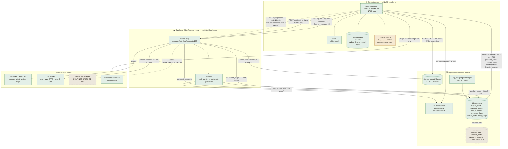
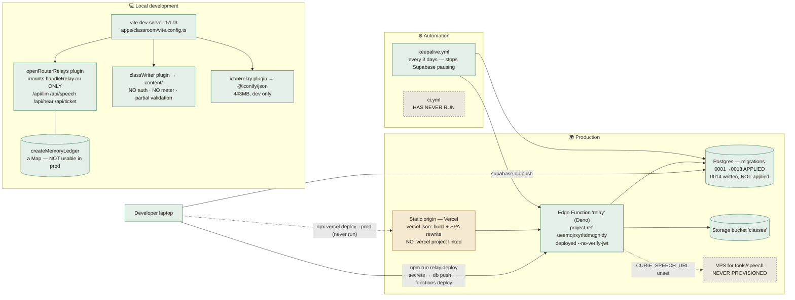
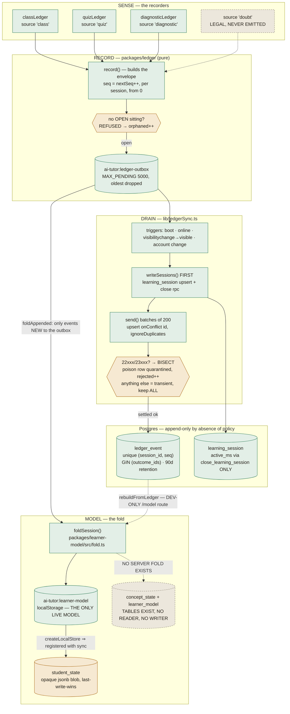
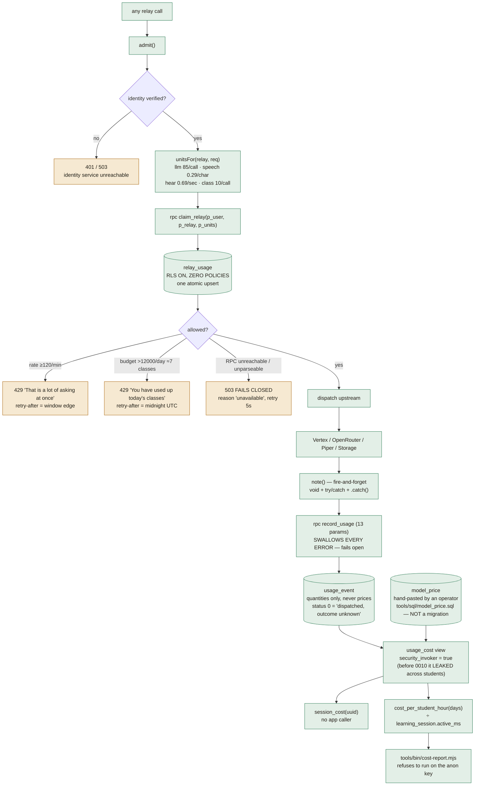
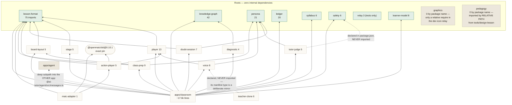
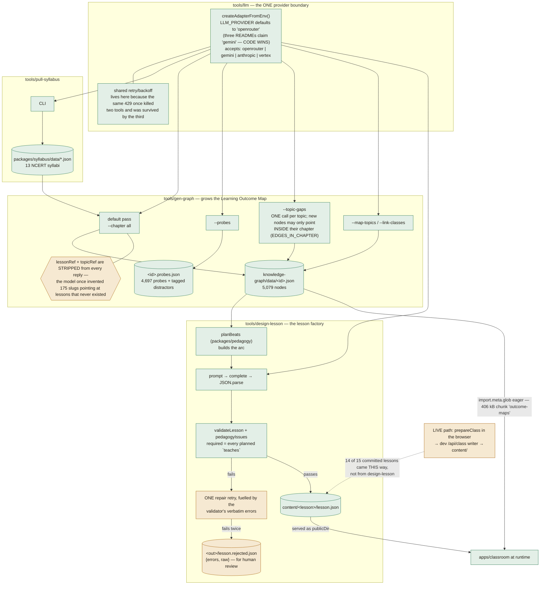

<!-- GENERATED FILE - do not edit directly.
     Edit README.template.md or diagrams/*.mmd, then run: node docs/architecture/build.mjs -->
# Curie — System Architecture

**For developers.** This is the wiring diagram: what talks to what, over which protocol, carrying which payload, and what happens when it fails. It is written from the **source**, not from the other docs in this repo — where a README and the code disagreed, the code won and the disagreement is called out.

Last mapped **2026-09-16** against `main` + branch `phase3-completion`.

### How to use and maintain this

The `.mmd` files in [`diagrams/`](diagrams/) are the **source of truth** and are plain [Mermaid](https://mermaid.js.org/). GitHub renders them inline below. To change a diagram:

```bash
# 1. edit the diagram
$EDITOR docs/architecture/diagrams/01-system-context.mmd
# 2. regenerate this README (injects every .mmd into the prose)
node docs/architecture/build.mjs
```

Paste any `.mmd` file into [mermaid.live](https://mermaid.live) to edit it visually.

### Reading the colours

| | meaning |
|---|---|
| 🟩 green | deployed and exercised by a student |
| 🟧 amber | built but not switched on, or configured but not deployed |
| ⬜ grey / dashed | written and **unwired** — no caller, no reader, or dev-only |

The grey boxes matter most. This repo contains a lot of correct, tested code that **nothing calls**, and that is the single biggest source of confusion for someone reading it for the first time. Every instance is named in [Written but not wired](#written-but-not-wired).

---

## 1. The system in one picture

A student on a phone asks for a topic. If nobody has had that class, it is **prepared live** — planned, drawn, checked — and starts teaching in about fourteen seconds while the artwork arrives behind them. The class is then **kept**, so the next student gets it for the cost of a download.

Two rules shape every wire below:

1. **The relay is the only thing that ever holds a vendor key.** The browser never does.
2. **Actuators report and execute; they never decide.**



<sub>Diagram source: [`diagrams/01-system-context.mmd`](diagrams/01-system-context.mmd) — edit that, then re-run `node docs/architecture/build.mjs`</sub>

**The three things that surprise people:**

- **The browser talks to Postgres directly.** The catalogue (`prepared_class`), the student's own stores (`student_state`), and the whole ledger (`ledger_event`, `learning_session`) are read and written by `supabase-js` with the **anon key under RLS**, completely bypassing the relay. The relay is for *vendor* calls, not for data access.
- **Storage is public and unauthenticated.** A kept class's `lesson.json` and pictures are fetched with no session at all.
- **`/api/icons` does not exist in production.** `handleRelay` answers `501` before `admit`, so every `graphic` noun in a live-prepared class renders as a dashed placeholder in the deployed app.

---

## 2. Deployment topology



<sub>Diagram source: [`diagrams/02-deployment.mmd`](diagrams/02-deployment.mmd) — edit that, then re-run `node docs/architecture/build.mjs`</sub>

**Environment differences that will bite you:**

| | local dev | production |
|---|---|---|
| Relay host | vite plugin, `apply: 'serve'` | Supabase Edge Function (Deno) |
| Routes through `handleRelay` | **only 4**: `/api/llm`, `/api/speech`, `/api/hear`, `/api/ticket` | **all of them** |
| `/api/class` | separate `classWriter` plugin — **no auth, no meter, partial validation**, writes to `content/` | `handleRelay` → `keepClass` → Storage + Postgres |
| `/api/icons` | `iconRelay` plugin over `@iconify/json` (443 MB) | **501, hard-coded** |
| Meter | `createMemoryLedger` — a `Map` | `claim_relay` in Postgres |
| Ticket secret | literal `'dev-only-ticket-secret'` | `RELAY_TICKET_SECRET` |
| JSON response headers | **dropped** by `node.ts` — a 429 loses its `Retry-After` | preserved by `web.ts` |

`supabase/functions/relay/index.ts` carries `@ts-nocheck` and sits outside `tsconfig.json`'s include list. The only thing catching drift between it and `handler.ts` is the deliberate `const deps: HandlerDeps` annotation at `index.ts:119`, checked by the Supabase CLI at deploy time.

**`--no-verify-jwt` is required, not a hole.** `/relay/speech` is an `<audio src>` and cannot carry an `Authorization` header; the platform's JWT check would reject it before this code runs. Auth is done for every route inside `admit()`.

---

## 3. Runtime — preparing a cold class

Measured once end-to-end on 2026-09-13: **~96 s** of preparation, **₹18.98** all in (₹9.08 prep + ₹9.90 playback). The room opens at **~14 s** on the draft, before any artwork lands.

```mermaid
%% Curie — Preparing a COLD class live. ~14s to first frame, ~96s full (measured 2026-09-13, ₹18.98).
%% Every LLM hop goes through the relay; the browser never holds a vendor key.
sequenceDiagram
    autonumber
    actor S as Student
    participant LC as LiveClassRoute
    participant PC as packages/class-prep<br/>prepareClass
    participant RL as relay /api/llm
    participant VX as Vertex AI
    participant WC as Wikimedia Commons
    participant API as relay /api/class
    participant PGS as Postgres + Storage

    S->>LC: taps a cold topic
    LC->>PC: prepareLiveClass(topicRef, outcomes, studentLines)
    PC->>RL: planner call (gemini-3.7-flash, json_object)
    RL->>VX: generateContent
    VX-->>RL: blueprint JSON
    RL-->>PC: OpenAiReply
    Note over PC: parsePlan → unreadable JSON?<br/>ONE re-ask, then throw
    PC->>PC: dropInventedOutcomes (invented id = dropped, never repaired)
    PC->>PC: assemble → layoutBeat → validateLesson
    alt validation or classMustAsk fails
        PC->>RL: ONE repair round with up to 10 NAMED problems
    end
    PC-->>LC: onDraft(lesson) — THE ROOM OPENS HERE (~14s)
    LC-->>S: class starts; artwork streams in behind

    par picture ladder (cheapest first)
        PC->>WC: search
        WC-->>PC: candidates
        PC->>PC: mayReuse — ABSENT licence = refusal (fails closed)
        PC->>RL: eyes.look (vision verify, max 3 tries)
    and generated fallback
        PC->>RL: imageArtist.draw → data:image
        PC->>RL: eyes.look → ONE redraw only if a NAMED fault
    end
    PC->>PC: verifySvg → unsafeMarkup (REJECT, never sanitise)
    PC-->>LC: onAsset per landed picture
    PC->>PC: assemble (re-fit with real art)

    Note over LC: class ends
    LC->>LC: saveable() — 4 refusals: personal name,<br/>shared-past phrase, incomplete, failed visual
    LC->>API: POST SavedClass
    API->>API: checkSavedClass (id slug, ≤24 files, ≤12MB, markup gate)
    API->>PGS: files to Storage FIRST
    API->>PGS: prepared_class row LAST (ignore-duplicates)
    Note over PGS: row last ⇒ a partial failure leaves<br/>invisible files, never a broken catalogue entry
```

<sub>Diagram source: [`diagrams/03-cold-class-prep.mmd`](diagrams/03-cold-class-prep.mmd) — edit that, then re-run `node docs/architecture/build.mjs`</sub>

**The rules encoded above:**

- **Reject, never sanitise.** Model-written markup that is not fully understood is refused — and the gate (`packages/relay/src/markup.ts`) runs on the **server**, because a browser-side gate protects only traffic that chooses to walk through it. A hand-made `POST` of `<svg><g><script>` used to get a 200.
- **An invented outcome id is dropped, not repaired.** One bad field is not a bad class, and a repair round would cost a student thirteen seconds of blank board.
- **The catalogue row goes last.** A partial failure leaves invisible orphan files rather than a row every student can see and none can open.
- **Optimistic validation.** `assemble` validates, fires `onDraft`, and *then* the pictures are fetched; the re-fit happens behind the running class.

---

## 4. Runtime — playing a class that already exists

```mermaid
%% Curie — Playing a class that already exists. A cache hit is a download: ₹9.90, no planner, no artist.
sequenceDiagram
    autonumber
    actor S as Student
    participant LR as LessonRoute
    participant CT as lib/content.ts
    participant PG as Postgres prepared_class
    participant ST as Storage bucket 'classes'
    participant PL as PlayerController
    participant SC as packages/stage Scene
    participant VO as packages/voice

    S->>LR: opens a topic
    LR->>CT: fetchCatalog()
    par authored lessons
        CT->>CT: GET /index.json (served from content/ as publicDir)
    and kept classes
        CT->>PG: select id, topic_ref, title, klass, subject<br/>WHERE klass BETWEEN mine-2 AND mine
        Note over CT,PG: anon key + RLS 'anyone may read prepared classes'.<br/>BYPASSES THE RELAY ENTIRELY.
        alt query stalls
            CT-->>CT: 4s Promise.race → [] → authored lessons only<br/>(a prepared topic looks cold and is prepared again)
        end
    end
    CT-->>LR: CatalogEntry[] — isAbsolute(path) tells kept from authored

    LR->>ST: GET /storage/v1/object/public/classes/&lt;id&gt;/lesson.json
    Note over LR,ST: public bucket, NO session at all
    ST-->>LR: lesson.json
    LR->>LR: validateLesson() → pointAtItsOwnFolder()<br/>rewrites element.src to the Storage folder
    alt validateLesson fails
        LR-->>S: "Lesson &lt;title&gt; is not available right now."<br/>errors go to console for the author only
    end

    LR->>ST: GET assets.json (else per-file SVGs)
    Note over LR,ST: a reply not starting with '&lt;svg' is REJECTED —<br/>the SPA fallback returns index.html with a 200
    LR->>VO: useLessonVoice(entry, lesson)
    VO->>ST: GET &lt;folder&gt;/narration.json (NarrationManifest)
    Note over VO: absent for every lesson but class10-blood ⇒<br/>ladder starts at on-device, then relay, then robot

    loop each beat
        PL->>VO: speak(fill[beatId].say + beat.narration) as ONE utterance<br/>(fill is an ARRAY looked up by beatId;<br/>no match means the bare narration)
        PL->>VO: prime(next beat's exact string)
        PL->>SC: beatchange → render diagram / image / graphic
    end
```

<sub>Diagram source: [`diagrams/10-warm-playback.mmd`](diagrams/10-warm-playback.mmd) — edit that, then re-run `node docs/architecture/build.mjs`</sub>

---

## 5. The in-class answer loop

This is the **SENSE → VERIFY → RECORD** path. It is where every piece of evidence the product is built on comes from.

```mermaid
%% Curie — The in-class answer loop: how one spoken answer becomes evidence.
%% This is the SENSE → VERIFY → RECORD path of the control plane.
sequenceDiagram
    autonumber
    participant PL as PlayerController
    participant CR as ClassRoom.tsx
    participant TTS as packages/voice<br/>4-layer ladder
    participant EAR as lib/ear.ts
    participant RH as relay /api/hear
    participant JG as packages/tutor-judge
    participant CL as lib/classLedger.ts
    participant OB as outbox<br/>localStorage

    PL->>TTS: speak(fill.say + beat.narration) as ONE utterance
    TTS-->>PL: resolved (a REJECTION is treated as finished — anti-stall)
    PL->>CR: pendingAsk revealed only AFTER onSpeechDone
    CR->>CL: asked() — guarded by askFiled so a pause files no second ask
    CL->>OB: {kind:'asked', assistanceRung, attempt, optionCount}

    alt spoken answer
        CR->>EAR: open mic (endpointer, graceMs 7000)
        alt silence 7s
            EAR-->>CR: {text:null, reason:'silence'} — nothing billed
        else mic denied / unavailable
            EAR-->>CR: {text:null, reason:'error'} → chips are the only path
        else heard
            EAR->>RH: POST 16kHz mono WAV (audio/wav only, ≤2MB)
            RH-->>EAR: {text} via nova-3, language=multi (CONSTANT)
            EAR-->>CR: transcript
            CR->>JG: judgeSpokenAnswer(ask, heard)
            alt judge fails or verdict 'unclear'
                JG-->>CR: null / unclear → NOTHING recorded
            else verdict right|wrong
                JG-->>CR: {verdict, say, gave, heard}
                opt wrong
                    CR->>CL: helped(beatId, rung 2 or 3, requested=false)
                    CL->>OB: {kind:'helped', rung, requested}
                end
                CR->>CL: answered({correct, surface:'voice', verdict,<br/>answerText = judged.heard — the SCREENED text})
            end
        end
    else tapped chip
        CR->>CL: answered({correct, surface:'tap', chosenIndex})
    end

    CL->>OB: {kind:'answered', outcomeIds, chosenIndex, correct,<br/>ms, attempt, assistanceRung, hintsShown, verdict,<br/>misconceptionId, answerNormalised}
    Note over CL,OB: rungOf(state) is derived from the AskState map;<br/>highestRung is monotonic per beat

    opt raise hand
        CR->>CL: confused(beatId) + helped(beatId, rung 7, requested=true)
    end
    Note over CR,OB: class ends → taught event over outcomesOf(lesson),<br/>then closeSitting(true)
```

<sub>Diagram source: [`diagrams/04-in-class-answer-loop.mmd`](diagrams/04-in-class-answer-loop.mmd) — edit that, then re-run `node docs/architecture/build.mjs`</sub>

**Non-obvious behaviour:**

- A TTS `speak()` promise that **rejects** is treated as finished speech (`then(onSpeechDone, onSpeechDone)`). *A stuck beat is a dead class.*
- A `200` from the transcriber with an **empty `text`** is filed as `silence` — a child who spoke is recorded as a child who said nothing.
- `verdict: 'unclear'` records **nothing**. It is not evidence about the student.
- The ledger receives `judged.heard` — the **screened** text — never the raw transcript. This is enforced only by convention at the call site.
- **The advance gate opens on any reply when an ask carries no options** (`const correct = option ? option.correct === true : true`). That is not an edge case: **none of the 22 asks in the 15 committed lessons carries options**, so today the gate always opens on the first tap.
- The mic stops reopening after **two** spoken misses. *A mic that reopens forever nags.*

---

## 6. Evidence → record → model

The ledger is the **system of record**; everything downstream reads it as ground truth. It shipped before the demo because *capture cannot be backfilled*.



<sub>Diagram source: [`diagrams/05-evidence-to-model.mmd`](diagrams/05-evidence-to-model.mmd) — edit that, then re-run `node docs/architecture/build.mjs`</sub>

### The event envelope

Nine kinds, four sources, three surfaces — all mirrored as CHECK constraints on `ledger_event`:

```ts
interface LedgerEvent {
  id: string          // device-minted uuid — the idempotency key
  sessionId: string
  seq: number         // per session, from 0. Ordering NEVER uses `at`.
  at: string          // the device clock, explicitly UNTRUSTED
  kind: 'session-started'|'session-ended'|'asked'|'answered'|'helped'
      | 'taught'|'confused'|'intervened'|'reflected'
  source: 'class'|'quiz'|'diagnostic'|'doubt'
  surface: 'tap'|'voice'|'text'
  outcomeIds: string[]
  topicRef?: string
  payload: EventPayload
}

interface AnsweredPayload {
  probeId?: string; beatId?: string
  chosenIndex?: number | null        // reinterpreted by surface in fold.chosenIndexFor()
  correct: boolean; ms: number; attempt: number
  assistanceRung: 0|1|2|3|4|5|6|7|8  // rung 0 is the ONLY rung that may move unassistedMastery
  hintsShown: number
  verdict?: 'right'|'wrong'|'unclear'
  misconceptionId?: string
  answerNormalised?: string          // screened + masked; undefined if flagged
}
```

### Delivery guarantees

| situation | behaviour |
|---|---|
| offline | events queue in localStorage; drain on `online`, `visibilitychange→visible`, account change, boot |
| outbox > **5,000** events | **oldest discarded**, `dropped++`, reported once per session as `ledger_dropped` |
| no open sitting | event **refused**, `orphaned++` — always a bug in us |
| Postgres 22xxx/23xxx | **bisect** the batch (~16 requests for one bad row in 200), quarantine the poison row, `rejected++` |
| anything else (RLS 42501, expired token, gateway) | **transient** — acknowledge nothing, keep the whole outbox, retry next drain |
| session upsert or close RPC fails | those event ids are **held back** from acknowledgement and re-sent |
| a different student signs in with a queue pending | queue is **emptied**, not uploaded under the new name |
| `crypto.randomUUID` unavailable (http on a LAN) | hand-built v4 with version + variant bits — a non-uuid id is refused by the column with 22P02 **forever** |

**Idempotency is only on re-send, never on re-record.** Ids are minted at record time, so the same answer recorded twice is two rows. This is why `ledger.answered` has exactly one call site per surface.

**A backgrounding splits one class into several sittings** — each with a fresh session id, `seq` reset to 0, and `activeMs` reset to 0. `seq` is only monotonic *within* a sitting; the canonical total order downstream is `(learning_session.started_at, seq)`.

### Where the loop stops

`foldSession` runs **on the device**, at record time, and writes `ai-tutor:learner-model` in localStorage. Because that is a `createLocalStore`, it is registered with `lib/sync.ts` and reaches Postgres as **one opaque jsonb blob** in `student_state` — whole-blob last-write-wins, under a policy the student can also DELETE.

`concept_state` and `learner_model` (migration 0013) are the tables written to fix exactly that. **Nothing in `apps/`, `packages/` or `supabase/functions/` reads or writes either one.** The only code that names them is `tools/bin/model-live-test.mjs`, which asserts a student *cannot* write them. There is no server-side fold; `supabase/functions/` contains only `relay`.

---

## 7. Identity, tickets and tenancy

```mermaid
%% Curie — Identity, the speech ticket, and tenancy. The student never types anything to get an id.
sequenceDiagram
    autonumber
    participant APP as apps/classroom
    participant GT as Supabase GoTrue
    participant TRG as trigger on_auth_user_created
    participant RLY as relay
    participant AUD as &lt;audio&gt; element

    Note over APP: boot — before React renders
    APP->>GT: signInAnonymously()
    GT-->>APP: durable anonymous user + JWT
    GT->>TRG: INSERT auth.users
    TRG->>TRG: provision_solo_org()<br/>organization(kind='solo') + membership(role='student')

    Note over APP,RLY: every fetch-based relay call
    APP->>RLY: Authorization: Bearer &lt;JWT&gt; + x-session-id
    RLY->>GT: GET /auth/v1/user (apikey=anon)
    GT-->>RLY: {id} — memoised 30s, SUCCESSES only

    Note over APP,AUD: speech cannot send a header
    APP->>RLY: POST /api/ticket (NOT metered — runs before admit)
    RLY-->>APP: base64url(userId).&lt;expiresAt&gt;.&lt;HMAC-SHA256&gt;<br/>TTL 10 min, renewed 60s early
    APP->>AUD: src = /api/speech?text=…&ticket=…&session=…
    AUD->>RLY: GET (no Authorization header possible)
    RLY->>RLY: readTicket → else fall through to header → else 401

    Note over APP,GT: sign-up UPGRADES the same identity
    APP->>GT: auth.updateUser({email, password})
    Note right of GT: user id UNCHANGED ⇒ student_state,<br/>ledger_event, membership all stay put.<br/>Fallback branch signUp() mints a SECOND<br/>user and a SECOND solo org.

    Note over APP,GT: sign-out on a shared phone
    APP->>APP: forgetTicket() bumps `era`,<br/>claimOutbox() EMPTIES a foreign queue
```

<sub>Diagram source: [`diagrams/06-auth-identity.mmd`](diagrams/06-auth-identity.mmd) — edit that, then re-run `node docs/architecture/build.mjs`</sub>

- **Every install gets a durable anonymous identity at boot**, before React renders. That INSERT on `auth.users` fires `provision_solo_org()`, which is where every `organization` + `membership` row comes from.
- **Sign-up upgrades in place** via `updateUser`, so the user id never changes and a term's work survives. The fallback branch (no anonymous session on the device) calls `signUp` and mints a **second** user and a **second** solo org.
- **The speech ticket** is `base64url(userId).<expiresAtMs>.<HMAC-SHA256>`, TTL 10 minutes, renewed 60s early. `readTicket` returns one null for bad shape, bad signature, expiry or empty user — never three distinguishable reasons.
- **Speech auth is ticket-OR-header**, not ticket-only. Every other relay is header-only.
- **If `RELAY_TICKET_SECRET` is unset**, speech accepts only an Authorization header — which an audio element cannot send — so speech **silently stops working rather than opening up**.
- **Append-only is enforced by the absence of an update/delete policy**, not by a rule. RLS denies what no policy allows. Any future "small" policy addition on `ledger_event` silently converts a measurement into a claim.
- **A forbidden write under RLS is usually a 204 that changes nothing, not a 403.** The live tests assert by reading rows back — an earlier check written against status codes passed for a week on a table anybody could have rewritten.
- **A minted ticket cannot be revoked.** `readTicket` checks a signature and an expiry and *nothing else* — there is no lookup, no denylist, no user-still-exists check. A leaked ticket is valid for its full 10 minutes no matter what happens to the account. (The 30-second `cacheVerifier` window is the small revocation gap; this is the large one.)
- **Session ids are caller-supplied and never validated.** `sessionOf()` reads `?session=` for speech and the `x-session-id` header for everything else, straight off the request, and passes it to `record_usage` as `p_session` with no check that the session belongs to that user. Metering attribution is therefore trusted input.
- **A live ticket outliving its user turns a 401 into a 503.** `relay_usage.user_id` cascades on `auth.users` delete, so `claim_relay` for a deleted user id raises inside the definer function, and `createSupabaseLedger` maps any non-ok reply to `unavailable`.
- **`lib/account.ts` is where identity binds to data.** `follow()` calls `handOverDevice(account.id)` **before** `connectSync(createSupabaseBackend(account.id))` — that ordering is what stops a new student's first class being binned by a later claim.
- **Tenancy exists but is unused.** `organization → membership(role)` ships with only the `student` role populated. `membership` has **no `id` column**, which bites `select=id` probes.

---

## 8. The meter and the books

**One unit = one paisa of vendor spend.** The meter **fails closed**; the accounting **fails open**.



<sub>Diagram source: [`diagrams/07-metering-and-cost.mmd`](diagrams/07-metering-and-cost.mmd) — edit that, then re-run `node docs/architecture/build.mjs`</sub>

- `UNITS_PER_DAY = 12_000` (about 7 classes) and `REQUESTS_PER_MINUTE = 120` are written down **twice** — in `packages/relay/src/gate.ts` and as plpgsql constants inside `claim_relay` (migration 0012). `apps/classroom/tests/migrations.test.ts` regex-parses the SQL and asserts they are equal, because shipping repriced units against the old 3,000 ceiling cut a student off mid-class.
- **Per-relay prices are not duplicated** — they live only in TypeScript and arrive at Postgres as `p_units`.
- **Quantities live in `usage_event`, prices in `model_price`.** Cost is a read-time join, so correcting a price re-prices history. A missing price surfaces as `unpriced = true`, never as zero.
- **`tools/sql/model_price.sql` is applied by no script, deliberately** — prices are a fact about someone else's contract, so the person who pays confirms them by hand. Until then `price_at()` returns null for everything and `cost_per_student_hour` reports a floor.
- **`usage_cost` is a view, and views do not inherit the row security of the table beneath them.** Before migration 0010 it ran as its definer and a brand-new anonymous account read five other students' sessions and spend. The fix needed **both** `security_invoker = true` **and** an outright revoke.
- **A Piper call is still recorded as OpenRouter spend** — `usageFromSpeech` hardcodes `provider: 'openrouter'`.
- **The usage sink never checks its reply.** `createSupabaseUsage.record` awaits the POST to `rpc/record_usage` and inspects nothing — no `res.ok`, no body. A 401, a revoked service-role key or a PostgREST schema error is indistinguishable from a written row, and the books go quietly empty.
- **`/api/ticket` is not metered at all** — it is dispatched before `relayFor` and before `admit`.
- **Refusals that cost money:** for `llm`, `admit` runs *before* the 405/413 checks, so a `GET /api/llm` from a signed-in user is charged 85 units and then answered 405. For `class`, the checks run first and a refusal is free.

---

## 9. Error, retry and fallback

Every ladder in the system. Nothing here is announced to the student.

```mermaid
%% Curie — Every degradation ladder. Each rung falls to the next; nothing is announced to the student.
%% The house rule: "a stuck beat is a dead class" — a rejected promise counts as finished speech.
flowchart TB
    subgraph V["🔊 VOICE — packages/voice"]
        V1["recorded take (.m4a)"] -->|"hash mismatch · unsafe file · 404 · decode fail"| V2["on-device Supertonic"]
        V2 -->|"263MB model absent / OOM<br/>(EVERY line in this checkout)"| V3["streaming relay /api/speech"]
        V3 -->|"401 no ticket · 429 · 503 · dead net<br/>NO retry, NO backoff"| V4["browser speechSynthesis"]
        V4 -->|"missing (old WebView)"| V5["timer TTS — silent, still advances"]
    end

    subgraph E["🎤 EAR — lib/ear.ts"]
        E1["mic + endpointer"] -->|"denied / OS took it"| E4
        E1 -->|"silence 7s — nothing billed"| E4
        E1 --> E2["POST /api/hear (WAV only, ≤2MB)"]
        E2 -->|"401·413·415·429·503<br/>NO on-device fallback — deliberately removed"| E4["tapped chips — the only remaining path"]
        E2 -->|"200 with empty text"| E5["filed as SILENCE<br/>a child who spoke is recorded as silent"]
    end

    subgraph P["🖼️ PICTURES — packages/class-prep"]
        P1["Wikimedia Commons search"] -->|"unreachable · no reusable licence<br/>ABSENT licence = refusal (fails closed)"| P4
        P1 --> P2["vision verify, max 3 tries"]
        P2 -->|"unparseable verdict = NO<br/>(the one parse failure that does not degrade)"| P4
        P2 -->|"wrong subject / printed text"| P4["generate with imageArtist"]
        P4 -->|"ONE redraw, only on a NAMED fault"| P5["dashed frame + alt text"]
    end

    subgraph PL["📝 PLANNER — prepare.ts"]
        PL1["planner reply"] -->|"unreadable JSON"| PL2["brace-slice → ONE re-ask"]
        PL2 -->|"fails twice"| PLX["THROW: 'did not return readable JSON, twice'"]
        PL1 --> PL3["validateLesson + classMustAsk"]
        PL3 -->|"ONE repair round, ≤10 NAMED problems"| PL4["invented outcome id → DROPPED, never repaired"]
        PL3 -->|"still invalid"| PLX
    end

    subgraph VX["⚡ VERTEX — vertex.ts"]
        X1["call"] -->|"408·429·502·503·504"| X2["backoff [1000ms, 3000ms]<br/>3 attempts total"]
        X2 -->|"still failing"| X3["pass the status through as OpenAI-shaped error"]
        X4["bad service account JSON"] -->|"caught at module scope"| X5["WHOLE relay falls back to OpenRouter"]
    end

    subgraph L["📒 LEDGER — ledgerSync.ts"]
        L1["send batch of 200"] -->|"22xxx / 23xxx"| L2["BISECT recursively (~16 requests)"]
        L2 --> L3["single poison row → quarantine, rejected++"]
        L1 -->|"anything else: 42501 RLS, expired token, gateway"| L4["TRANSIENT — acknowledge NOTHING,<br/>keep the whole outbox, retry next drain"]
        L5["offline"] --> L6["queue in localStorage → drain on online"]
        L7["outbox > 5000"] --> L8["OLDEST discarded, dropped++"]
    end

    subgraph D["🙋 DOUBT — the raised hand"]
        D1["Gemini Live WebSocket"] -->|"DEV BUILDS ONLY — absent in production"| D2
        D1 -->|"setup timeout / socket error"| D1b["failover to 2nd LIVE_MODEL, only if she has not spoken"]
        D2["typed doubt agent via /api/llm"] -->|"call fails or error body"| D3["scripted stub — same persona, from the lesson"]
        D4["settings.klass unset"] --> D3
    end

    classDef top fill:#e3efe7,stroke:#2c7a54,color:#231e16
    classDef mid fill:#f6e9d2,stroke:#a9660f,color:#231e16
    classDef floor fill:#ece7dc,stroke:#7c7565,color:#231e16
    class V1,E1,P1,PL1,X1,L1,D1 top
    class V2,V3,E2,P2,PL2,X2,L2,D2,D1b mid
    class V4,V5,E4,E5,P4,P5,PL4,PLX,X3,X5,L3,L4,L6,L8,D3 floor
```



<sub>Diagram source: [`diagrams/08-failure-ladders.mmd`](diagrams/08-failure-ladders.mmd) — edit that, then re-run `node docs/architecture/build.mjs`</sub>

**The retry budgets, exhaustively:**

| what | policy |
|---|---|
| Vertex 408/429/502/503/504 | `BACKOFF_MS = [1000, 3000]` — **3 attempts**, then pass the status through. Vertex's own Retry-After wins but is clamped to 5s |
| Vertex anything else (400, 401) | returned as-is, OpenAI-shaped. Never a throw — **except** a network-level rejection, which is bare inside the retry loop and escapes `completeOnVertex`, so the usage record never fires |
| planner unreadable JSON | brace-slice, then **one** re-ask, then throw |
| lesson fails validation | **one** repair round with up to 10 named problems, then throw |
| generated picture has a named fault | exactly **one** redraw, kept only if it comes back clean |
| Commons candidate verification | up to **3** tries; a dead link costs no vision call |
| speech relay refusal | **no retry, no backoff** — straight to the browser voice |
| `/api/hear` refusal | **no retry, no on-device fallback** — the chips are the only path left |
| ledger transient failure | keep everything, retry on the next drain trigger |
| the meter itself is down | **503, fails closed.** A limit that disappears during an outage is not a limit |

**Fail-closed vs fail-open, deliberately split:**

- **Closed:** the meter (`claim_relay` unreachable → 503), identity verification (unreachable → 503), image licence checks (an *absent* licence is a refusal), the vision verifier (unparseable verdict = NO), the markup gate.
- **Open:** usage accounting (every error swallowed — on Deno an unhandled rejection can take the isolate down mid-reply), cloud sync (the device is the source of truth), the catalogue query (4s race, then authored lessons only).

**The doubt tutor's replies are NOT safety-screened.** `speakSafely`/`toStudent` screens the judge and the cross-question, but `ClassRoom.tsx` hands the handoff a raw `speak: (text) => tts.speak(text)`, so every line from `geminiAgent` or the scripted stub reaches the speaker unscreened. The student's *input* is screened on that path; the model's *output* is not.

**Safety halts the class.** A turn the safety screen reads as distress stops the lesson and speaks a helpline (Tele-MANAS 14416, Childline 1098); the class is not resumed automatically. A phone number or prompt-injection pattern in an answer is **cleaned, not refused** — the student did nothing wrong.

---

## 10. The data model

Migrations 0001 → 0013 are **applied**. `0014_concept_state_evidence_columns.sql` is **written and not applied**.

```mermaid
%% Curie — Postgres schema after migrations 0001→0013 (0014 written, NOT applied).
%% Append-only tables are append-only BY THE ABSENCE of an update/delete policy, not by a rule.
erDiagram
    AUTH_USERS ||--o{ MEMBERSHIP : "cascade"
    AUTH_USERS ||--o| RELAY_USAGE : "cascade"
    AUTH_USERS ||--o{ STUDENT_STATE : "cascade"
    AUTH_USERS ||--o{ LEARNING_SESSION : "cascade"
    AUTH_USERS ||--o{ LEDGER_EVENT : "cascade"
    AUTH_USERS ||--o{ USAGE_EVENT : "cascade"
    AUTH_USERS ||--o{ CONCEPT_STATE : "cascade"
    AUTH_USERS ||--o| LEARNER_MODEL : "cascade"
    ORGANIZATION ||--o{ MEMBERSHIP : "has"
    ORGANIZATION ||--o{ LEARNING_SESSION : "org_id"
    ORGANIZATION ||--o{ LEDGER_EVENT : "org_id"
    LEARNING_SESSION ||..o{ LEDGER_EVENT : "session_id — NO FK (outbox may land first)"
    LEARNING_SESSION ||..o{ USAGE_EVENT : "session_id — NO FK"
    USAGE_EVENT }o--|| MODEL_PRICE : "priced at read time by price_at()"

    AUTH_USERS {
        uuid id PK "INSERT fires provision_solo_org()"
    }
    ORGANIZATION {
        uuid id PK
        text kind "solo | school — only 'solo' is ever written"
        text name
    }
    MEMBERSHIP {
        uuid org_id PK
        uuid user_id PK "NO id column — bites select=id probes"
        text role "admin|teacher|student — only 'student' populated"
    }
    STUDENT_STATE {
        uuid user_id PK
        text key PK "ai-tutor:profile, :settings, :learner-model, …"
        jsonb value "WHOLE-BLOB last-write-wins"
        bigint updated_at
    }
    RELAY_USAGE {
        uuid user_id PK
        date day
        int day_units "ceiling 12000/day"
        timestamptz window_start
        int window_count "ceiling 120/min"
    }
    PREPARED_CLASS {
        text id PK "slugified topicRef"
        text topic_ref UK
        text title
        text subtitle
        int klass
        text subject
    }
    LEARNING_SESSION {
        uuid id PK "client-minted"
        uuid org_id FK
        uuid user_id FK
        text source "class|quiz|diagnostic|doubt"
        text topic_ref
        timestamptz started_at "device clock"
        timestamptz ended_at "only via close_learning_session()"
        int active_ms "denominator of the primary metric"
        timestamptz received_at "server clock — retention ages on THIS"
    }
    LEDGER_EVENT {
        uuid id PK "device-minted idempotency key"
        uuid org_id FK
        uuid user_id FK
        uuid session_id "no FK"
        int seq "per session, from 0 — unique(session_id,seq)"
        timestamptz at "device clock, UNTRUSTED"
        timestamptz received_at
        text kind "session-started|session-ended|asked|answered|helped|taught|confused|intervened|reflected"
        text source
        text surface "tap|voice|text"
        text_array outcome_ids "GIN indexed"
        text topic_ref
        jsonb payload "shape typed ONLY in TypeScript"
    }
    USAGE_EVENT {
        uuid id PK
        uuid user_id FK
        uuid session_id "joins via x-session-id header"
        text relay
        text provider "vertex|openrouter|storage"
        text model
        int status "0 = dispatched, outcome unknown"
        int prompt_tokens
        int output_tokens
        int thought_tokens
        int characters
        int audio_bytes
    }
    MODEL_PRICE {
        text provider PK
        text model PK
        text unit PK
        timestamptz effective_from PK "a change is a NEW row"
        numeric inr_per_unit
    }
    CONCEPT_STATE {
        uuid user_id PK "NO WRITER, NO READER IN THE PRODUCT"
        text outcome_id PK
        real mastery
        real unassisted_mastery
        real assisted_performance
        int observations
        int unassisted_observations
        int taught_count
        timestamptz next_review_at "not driven"
        int answer_observations "0014 — NOT APPLIED"
        int doubt_count "0014 — NOT APPLIED"
    }
    LEARNER_MODEL {
        uuid user_id PK "NO WRITER, NO READER"
        timestamptz folded_through_at
        int folded_through_seq "TS FoldCursor also has sessionId — NO COLUMN"
        int version
    }
```



<sub>Diagram source: [`diagrams/09-database-er.mmd`](diagrams/09-database-er.mmd) — edit that, then re-run `node docs/architecture/build.mjs`</sub>

**Two clocks, on purpose.** `at` is the device's and is explicitly untrusted. `received_at` is Postgres's `now()`, and it is what retention and `cost_per_student_hour` both use — a phone set to 2019 would otherwise have its events purged on arrival.

**Nothing bounds `active_ms` against the wall clock**, and the migration says so. It is the denominator of both `cost_per_student_hour` and the primary metric, and it is still the student's own word — once.

**Every per-student table except `concept_state` and `learner_model` lacks `org_id`.** `student_state`, `relay_usage`, `prepared_class` and `usage_event` have no tenancy column at all. 0013 added it as a deliberate new pattern so teacher visibility becomes a policy change rather than a migration.

**Functions and who may call them:**

| function | grant | called by |
|---|---|---|
| `claim_relay(uuid,text,int)` | service_role only | the relay, before every upstream call |
| `record_usage(13 args)` | service_role only | the relay, fire-and-forget after |
| `close_learning_session(uuid,timestamptz,int)` | authenticated | the outbox drain — the **only** legal mutation on `learning_session` |
| `delete_own_account()` | authenticated | Settings; cascades **eight** tables |
| `is_member(uuid)` | authenticated | RLS policies (breaks recursion) |
| `price_at` / `session_cost` / `cost_per_student_hour` | service_role | `tools/bin/cost-report.mjs` |
| `purge_old_ledger(int)` | service_role | **only** the pg_cron job, 19:30 UTC daily |
| `provision_solo_org` / `drop_empty_solo_org` | triggers | `auth.users` INSERT / `membership` DELETE |

> **`spend_credits` does not exist.** It appears only as a future plan item. There is no such function and no caller. Do not draw it.

**PostgREST resolves an RPC by its argument names**, so POSTing `{}` to `record_usage` answers 404 exactly as if the migration had never run.

---

## 11. Contracts that cross a boundary

```ts
// packages/relay — the seam that makes dev and prod one implementation
interface RelayRequest  { method: string; url: string; headers: Record<string,string|undefined>; body: Uint8Array }
interface RelayResponse { status: number; headers: Record<string,string>
                          body: {kind:'json';value:unknown} | {kind:'bytes';value:Uint8Array} | {kind:'stream';from:UpstreamCall} }
interface UpstreamCall  { url: string; method: string; headers: Record<string,string>; body?: string; fallbackContentType: string }
//                        ^ the vendor key is placed HERE and, in the shipping path, never in the browser

type ClaimResult = { allowed: true }
                 | { allowed: false; reason: 'rate'|'budget'|'unavailable'; retryAfterSeconds: number }

const UNITS = { llm:{per:'call',units:85}, hear:{per:'second',units:0.69},
                speech:{per:'character',units:0.29}, class:{per:'call',units:10}, icons:{per:'call',units:1} }

// the browser always speaks OpenAI; it is never told whether Vertex or OpenRouter is behind it
interface OpenAiChat { model?: string; messages?: …; response_format?: {type?:'json_object'}
                       temperature?: number; reasoning_effort?: 'none'|'low'|'medium'|'high' }

// packages/learner-model — the belief, per outcome
interface ConceptState {
  outcomeId: string
  mastery: number; unassistedMastery: number; assistedPerformance: number
  observations: number; answerObservations: number; doubtCount: number
  unassistedObservations: number; taughtCount: number
  lastPracticedAt?: string; lastUnassistedSuccessAt?: string
  memoryStrength: number; nextReviewAt?: string      // present, NOT DRIVEN
  retrievalCount: number; retrievalAccuracy: number
}
type FoldCursor = { at: string; sessionId: string; seq: number }
//   ^ the SQL table's cursor is only (folded_through_at, folded_through_seq).
//     The sessionId tie-break HAS NO COLUMN. Anything persisting it server-side must add one.

// the controller contract — designed, no implementation
interface TutorAction {
  kind: 'teach'|'ask'|'hint'|'reteach-prerequisite'|'worked-example'|'analogy'|'retrieve'|'reflect'
  outcomeId: string
  assistanceRung: 0|1|2|3|4|5|6|7|8
  strategy?: 'visual'|'analogy'|'real-world'|'socratic'|'worked'|'step'
  because: string   // logged, never spoken
}
```

**Naming traps at the boundary:** the TypeScript field is `class`, the column is `klass`. `topic_ref: null` must be **omitted** on the way back in, not set to `topicRef: null`. `SavedClass.entry.path` is required by the type, validated by nothing, and stored nowhere — the browser rebuilds it on read.

---

## 12. The package graph



<sub>Diagram source: [`diagrams/11-package-graph.mmd`](diagrams/11-package-graph.mmd) — edit that, then re-run `node docs/architecture/build.mjs`</sub>

**There is no build step for any package.** Every `packages/*/package.json` points `main` and `types` straight at `src/index.ts`; TypeScript source is consumed raw by vite, vitest, tsc and bare node. Nothing is compiled or published, and everything is `private: true`.

**Three things here are load-bearing and wrong-looking:**

- **`apps/classroom` imports six packages it does not declare** — `learner-model`, `ledger`, `tutor-judge`, `safety`, `agent` (and `relay` in tests). It works only because npm workspaces symlinks every member into `node_modules`.
- **`apps/classroom` depends on an *app*.** `lib/liveKitAgent.ts` imports `@ai-tutor/agent/src/messages.ts` — a deep subpath into the other app's source tree, policed by nothing.
- **The two alias maps disagree.** `vitest.config.ts` has 21 aliases; `apps/classroom/vite.config.ts` has 19 (missing `teacher-clone` and `relay`). Neither has `agent`.

---

## 13. The authoring pipeline (offline)

This runs on a laptop before any student exists, and writes into the **repo** — not into Storage. It is a different path from the live `prepareClass`.



<sub>Diagram source: [`diagrams/12-authoring-pipeline.mmd`](diagrams/12-authoring-pipeline.mmd) — edit that, then re-run `node docs/architecture/build.mjs`</sub>

**Every LLM stage in every tool is the same loop**, implemented five separate times: prompt, complete, JSON.parse, validate, ONE repair retry fuelled by the validator's verbatim errors, give up. The rejected draft is written to a `*.rejected.json` for human review — with a **different filename convention per tool**.

**Documentation drift, where the code wins:** `createAdapterFromEnv` defaults `LLM_PROVIDER` to **openrouter**, while three READMEs claim gemini. `GEMINI_MODEL` defaults to `gemini-3.8-flash`, not `gemini-3.1-flash`.

**`design-lesson`'s blueprint path has run in anger exactly once** — `content/class9-particle-size` is its only output (b1..b11 + `assets-spec.json`). Of the 15 committed lessons, **10 came from the live `prepareClass` path** through the dev `/api/class` writer (they carry `assets.json` + `generated/`); the other 5 predate that route and came from `design-lesson`'s earlier topic-only path. Its prompt also exposes only 10 of `lesson-format`'s 17 element kinds.

---

## 14. Environment variables

`envDir` is repointed at the **repo root** (`vite.config.ts:377`). `apps/classroom/.env.local` exists and is **zero bytes**; its `.env.example` is a tombstone pointing here.

| variable | read by | required? |
|---|---|---|
| `SUPABASE_URL`, `SUPABASE_ANON_KEY`, `SUPABASE_SERVICE_ROLE_KEY`, `OPENROUTER_API_KEY` | Edge Function | **hard-required** — any blank one answers 503 `relay is missing: ...` |
| `RELAY_TICKET_SECRET` | Edge Function | absent means speech is header-only, so **speech stops working** |
| `GOOGLE_SERVICE_ACCOUNT_JSON` | Edge Function | absent falls back to OpenRouter (soft) |
| `CURIE_SPEECH_URL` | Edge Function / vite | optional; **unset today**, so speech goes to OpenRouter |
| `GOOGLE_SERVICE_ACCOUNT_FILE` | vite dev | default `.secrets/vertex-service-account.json`, resolved from the repo root |
| `VITE_RELAY_URL` | browser | blank in dev (relative paths); a **Capacitor build with it blank logs a startup error and every relay call fails** |
| `VITE_SUPABASE_URL`, `VITE_SUPABASE_ANON_KEY` | browser + every `tools/bin/*.mjs` | required; public by design |
| `VITE_SENTRY_DSN`, PostHog keys | `lib/telemetry.ts` | **absent, so telemetry is a complete no-op and every crash is invisible** |
| `VITE_GEMINI_API_KEY` | `ClassRoom.tsx`, into a Live WebSocket query string | **dev-fenced, but a real vendor credential in browser code** |
| `CURIE_VOICE`, `CURIE_VOICES`, `CURIE_SPEECH_PORT`, `CURIE_WHISPER` | `tools/speech/server.py` | only if self-hosting voice |
| `LLM_PROVIDER`, `GOOGLE_API_KEY`, `ANTHROPIC_API_KEY` | authoring tools | only for `design-lesson` / `gen-graph` / `pull-syllabus` |
| `RUNPOD_API_KEY`, `ELEVENLABS_API_KEY` | **nothing** | dead; present only as leak *shapes* in `check-bundle-secrets.mjs` |

`tools/bin/check-bundle-secrets.mjs` runs three passes — verbatim values from `.env.local` minus an explicit `PUBLIC_BY_DESIGN` allowlist, 24-character window shapes, and known key prefixes — so it works in CI with no `.env` at all.

---

## 15. Written but not wired

Correct, tested code that **nothing calls**. Read this before assuming a feature exists.

| thing | state |
|---|---|
| `concept_state` + `learner_model` tables | provisioned and RLS'd, with **no product reader or writer** — the server-side fold does not exist. `npm run model:verify` (`tools/bin/model-live-test.mjs`) reads them only to assert a student *cannot* write them |
| `packages/pedagogy` | zero imports *by package name*, but `tools/design-lesson` does call `pedagogyIssues` **by relative path**. So it is live at authoring time and **reaches no student** |
| `packages/graphics` declared surface | zero `@ai-tutor/graphics` imports; only a relative `require` inside the dev icon relay |
| `chooseAsk` (the asks layer) | shipped with tests and **no caller** — moved to Phase 6 |
| event kind `intervened` | in the union, in the CHECK constraint, has a payload type; **nothing constructs one** |
| event source `doubt` | legal everywhere; **never emitted** — a raised hand files `confused` inside the class sitting |
| event surface `text` | legal; every emitter passes `tap` or `voice` |
| `replayCounters` / `Counters` | exported and tested; **no production importer**. The counters it rebuilds are still written directly by `ClassRoom.tsx` |
| `unassistedGain` / `gainPerLearningMinute` | no **product** caller — but there *is* a wired operator runner: `npm run model:metric` → `tools/bin/model-metric.mjs`, which folds the metric off PostgREST |
| `/api/icons` in production | hard 501. Its `UNITS` entry and CHECK-constraint value can never be reached |
| `session_cost(uuid)` | no application caller; probed only to prove it is closed |
| `publicUrlFor` | no production caller — the browser rebuilds the URL itself |
| `tools/speech` `/hear` route | exists; transcription always goes to OpenRouter on both hosts |
| `/model` inspector | routed **inside `import.meta.env.DEV`** — in a production build nothing reads the server ledger back |
| Gemini Live WebSocket, `geminiAgent` direct providers | dev-only; they bypass `admit`, the meter and the usage sink entirely |
| `apps/classroom/prep5.ts`, `prep-clone.ts` | at the app root, referenced by no script, imported by nothing |
| `ci.yml` | has **never run**. Nothing in CI deploys anything |

---

## 16. Verifying any of this yourself

```bash
npm run typecheck                          # tsc across the workspace
npx vitest run                             # ~2,800 tests, three trees
npm run build                              # production bundle
node tools/bin/check-bundle-secrets.mjs    # nothing secret reached dist/

npm run relay:verify                       # verify-deploy + live-test against the DEPLOYED project
npm run model:verify                       # concept_state / learner_model readable, unwritable
node tools/bin/cost-report.mjs             # needs SUPABASE_SERVICE_ROLE_KEY; refuses the anon key
node tools/measure/model-cost.mjs          # cold Rs 18.98 / cached Rs 9.90 / Rs 164 per student-hour
```

The first four are the after-every-task routine. They are not optional — three of the worst defects in this repo's history were found by the fourth.

---

## 17. How this document was produced

Thirteen subsystems were mapped by independent agents reading the **source** (not the other docs), then each map was re-checked by a second agent against the cited files.

**That adversarial pass mattered.** Across the subsystems that completed it, roughly **one claim in five was overturned** — invented identifiers, drifted line numbers, and status labels that overstated reality. So the pass is not decoration, and the table below is not a formality.

### Verification status, per section

| section | source subsystem | claims checked |
|---|---|---|
| 1, 11 Relay & contracts | `relay` | 81 |
| 2 Deployment | `infra` | 43 |
| 3 Cold class prep | `class-prep` | 32 |
| 4, 5 Playback & answer loop | `app-runtime` | 32 |
| 6 Evidence → model | `ledger` | 43 |
| 6 Evidence → model | `learner-model` | 25 |
| 7 Identity & tickets | `auth` | 43 |
| 8 Meter & books | `observability` | 28 |
| 9 Error & fallback | `failure` | 14 |
| 10 Data model | `database` | 33 |
| 12 Package graph, 14 Env vars | `deps-config` | 32 |
| 13 Authoring pipeline | `authoring` | 22 |
| Learning Outcome Map detail | `knowledge-graph` | 31 |

**All thirteen completed the pass. 459 claims were opened and checked against the cited file; 148 of them — just under a third — did not survive.** Everything in this document is post-correction.

The corrections that changed the substance of this document, rather than a line number:

- **§13** — the committed lessons' provenance (10 of 15 from the live path, not 14).
- **§15** — the primary metric *does* have a wired runner (`npm run model:metric`).
- **§15** — `concept_state` has no *product* reader, but `npm run model:verify` reads it.
- **§12** — `pedagogy` and `graphics` are reached by **relative path**, so an import count of 0 by package name does not mean dead; and `tutor-judge → safety` and `teacher-clone → voice` are **declared in `package.json` but never actually imported**.
- **§9** — the doubt tutor's replies are not safety-screened.
- **§5** — the advance gate opens on any reply, because no committed ask carries options.

**Line numbers drift fastest in all of them.** Treat them as a starting point; trust the file and symbol names, which are stable.
